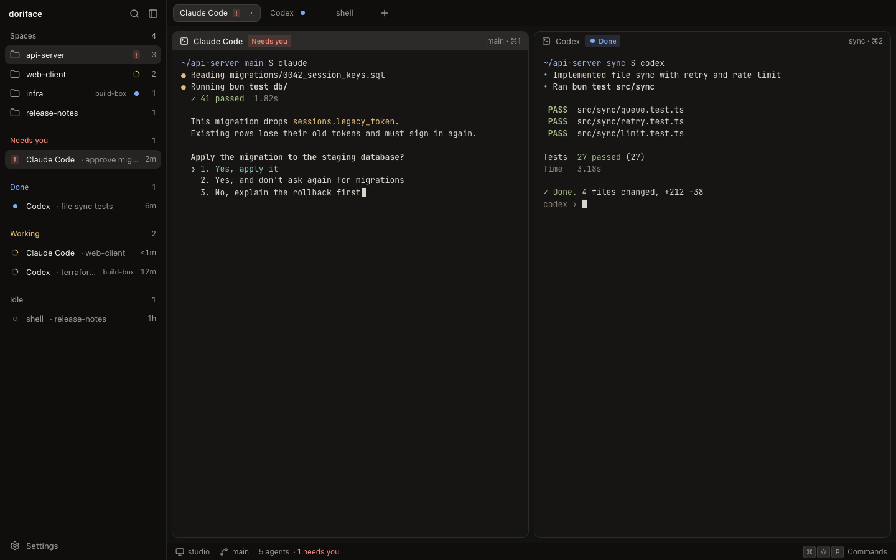
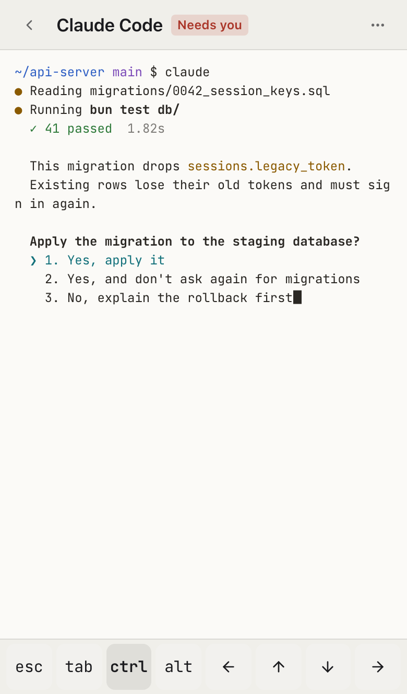

# doriface

An end-to-end encrypted web, PWA and desktop face for [herdr-core](https://github.com/herdrdev/herdr-core).

doriface runs a small host gateway next to `hc` and passes herdr-core's own JSON-RPC and framed terminal protocol straight through to your browser or desktop, so every `hc` method works without a translation layer. Traffic between your devices and the host is end-to-end encrypted; by default it travels through a public Cloudflare relay at `relay-doriface.omo.dev`, which only ever sees ciphertext. Terminals render with [libghostty](https://ghostty.org).

> Status: early development. The pieces below land as separate pull requests into `dev`.

## Layout

| Path                | What it is                                         |
| ------------------- | -------------------------------------------------- |
| `packages/protocol` | herdr-core wire codec (frames, JSON-RPC types)     |
| `packages/crypto`   | pairing, key exchange and encrypted records        |
| `packages/client`   | client SDK for web, desktop and future native apps |
| `packages/ui`       | design system: tokens and components               |
| `apps/host`         | Bun + Hono gateway that runs beside `hc`           |
| `apps/relay`        | Cloudflare Workers + Durable Objects relay         |
| `apps/web`          | React web client and installable PWA               |
| `apps/desktop`      | Electron shell                                     |

## Design

The design system lives in [DESIGN.md](DESIGN.md): herdr-compatible themes, tokens, the Base UI component set in `packages/ui`, and a brief for every screen. `bun run --filter @doriface/ui showcase` opens the primitives and mockups.

| Workspace (dark, 1440)                                            | Phone (light, 390)                                                 |
| ----------------------------------------------------------------- | ------------------------------------------------------------------ |
|  |  |

## Development

Requires [Bun](https://bun.sh) 1.4.4 or newer.

```sh
bun install
bun run check   # typecheck, lint, format check, tests
```

## License

[AGPL-3.0](LICENSE)
