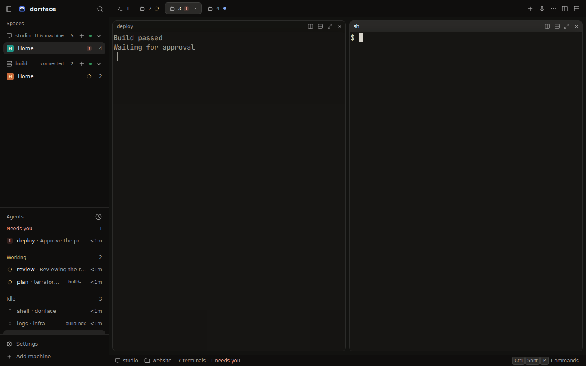
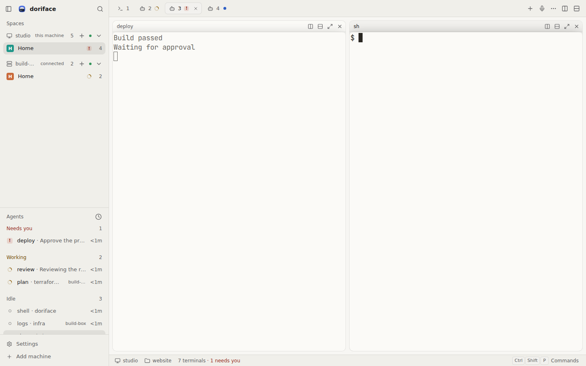

# doriface

An end-to-end encrypted web, PWA and desktop face for [herdr-core](https://github.com/herdrdev/herdr-core).

doriface runs a small host gateway next to `hc` and passes herdr-core's own JSON-RPC and framed terminal protocol straight through to your browser or desktop app, byte for byte, so every `hc` method works without a translation layer. Traffic between your devices and the host is designed to be end-to-end encrypted with Noise and, by default, carried through a public Cloudflare relay at `relay-doriface.omo.dev` that only ever sees ciphertext. That path is still landing; today a client reaches a host on the same machine (see Status). Terminals render with [libghostty](https://ghostty.org), built from Ghostty's own source.

| Workspace (night, 1440)                                             | Workspace (day, 1440)                                           |
| ------------------------------------------------------------------- | --------------------------------------------------------------- |
|  |  |

## Status

| Piece                                         | State                                                                                                                                                                                                                                   |
| --------------------------------------------- | --------------------------------------------------------------------------------------------------------------------------------------------------------------------------------------------------------------------------------------- |
| Host gateway, byte-for-byte `hc` passthrough  | works                                                                                                                                                                                                                                   |
| Web client and installable PWA                | works on the same machine as the host: in Settings, set "Connect through" to "Loopback dev" and paste the token from `doriface-host --print-token`                                                                                      |
| Desktop app ("Use this computer")             | works: starts the host and `hc` locally and attaches terminals                                                                                                                                                                          |
| Terminal rendering with libghostty            | works (Ghostty v1.4.0)                                                                                                                                                                                                                  |
| Public relay `relay-doriface.omo.dev`         | deployed                                                                                                                                                                                                                                |
| Pairing a device and reaching a host remotely | in progress: Noise encryption with CPace-based code pairing, transport contract v1.3 ([#7](https://github.com/sisyphuslabs/doriface/pull/7)), and the relay path end to end ([#17](https://github.com/sisyphuslabs/doriface/issues/17)) |

## How it fits together

```
browser / PWA / desktop ──┐                         ┌── doriface-host ── hc connect ── herdr-core
                          ├─ Noise (end-to-end) ────┤
     relay-doriface.omo.dev (sees ciphertext only) ─┘   or directly on your LAN
```

That is the target design. Today the web client and the desktop app reach the host over a token-gated, loopback-only `ws://127.0.0.1:7766/v1/hc` on the same machine.

The host never parses what `hc` says; it pipes the stream. The client SDK speaks herdr-core's protocol itself, so a future native app can reuse it. The full design is in [docs/architecture.md](docs/architecture.md), and the wire format every package is built against is the [transport contract](docs/transport.md).

## Other machines through the relay

`hc machine add` reaches other machines over ssh, or over any command given with `--via` that pipes `hc connect`. `doriface-host connect` is that command for a machine running `doriface-host`: it pipes stdin and stdout to that host's `hc connect`, end-to-end encrypted through the relay, so the machine needs no ssh and no open port.

```sh
doriface-host pair                                         # on machine B: prints a link and a code
doriface-host connect '<link>' < /dev/null                 # on machine A, once: pairs A as a device of B
#   or, with the typed code: doriface-host connect <code> --fingerprint '<first 4 groups B printed>' < /dev/null
#   re-pairing a host whose key or relay changed is refused unless you add --replace after checking the change
hc machine add --via 'doriface-host connect <B hostId>' --name b   # on A: B's terminals appear as b/t1, ...
```

## Layout

| Path                    | What it is                                                                 |
| ----------------------- | -------------------------------------------------------------------------- |
| `packages/protocol`     | herdr-core wire codec: frames and JSON-RPC types                           |
| `packages/client`       | client SDK for web, desktop and future native apps                         |
| `packages/relay-client` | relay uplink and session client                                            |
| `packages/ghostty-wasm` | libghostty-vt compiled to WebAssembly from Ghostty v1.4.0, with provenance |
| `packages/ui`           | design system: tokens, themes and components                               |
| `apps/host`             | `doriface-host`, the Bun + Hono gateway that runs beside `hc`              |
| `apps/web`              | React web client and installable PWA                                       |
| `apps/desktop`          | Electron shell                                                             |
| `tests/relay`           | the host and client against the relay, end to end                          |

The relay (Cloudflare Workers + Durable Objects, `relay-doriface.omo.dev`) is a separate private service,
`sisyphuslabs/doriface-relay`. Its public contract is the relay section of [docs/transport.md](docs/transport.md),
which every package here is built against.

## Development

Requires [Bun](https://bun.sh) 1.4.4 or newer, and [herdr-core](https://github.com/herdrdev/herdr-core) (`hc`) 0.1.17 on `PATH` to run the host, the desktop app, `bun run check` and the end-to-end tests.

```sh
bun install
bun run check                         # typecheck, lint, format check, API codegen check, tests
bun run --cwd apps/host start --print-token   # the host gateway on 127.0.0.1:7766; prints the client token
bun run --cwd apps/web dev            # the web client
bun run --cwd apps/desktop start      # the desktop app
bun run --cwd packages/ui showcase    # every component and screen mockup
```

`bun run --cwd apps/web test:e2e` and `bun run --cwd apps/desktop test:e2e` run the Playwright suites against a real `hc`. `bun run relay:test` runs `tests/relay` against the private relay at the commit `relay-pin.json` names: it clones it into `.relay` when your git credentials can read `sisyphuslabs/doriface-relay`, and otherwise says so and stops. `bun run check` does not need it. `bun run relay:dev` serves that relay locally.

## Design

The design system lives in [DESIGN.md](DESIGN.md): herdr-compatible themes, tokens, the component set in `packages/ui`, the accessibility rules every theme is tested against, and a brief for every screen. Screen mockups are in [docs/design/mockups](docs/design/mockups), and captures of the real app in [docs/design/app](docs/design/app).

## License

[AGPL-3.0](LICENSE)
